<picture>
  <source media="(max-width: 600px)" srcset="assets/hero-fr-mobile.svg">
  
</picture>

  <a href="https://akkouhlokmane.netlify.app/">Portfolio</a> &nbsp; / &nbsp;
  <a href="https://www.linkedin.com/in/lokmane-akkouh/">LinkedIn</a> &nbsp; / &nbsp;
  <a href="mailto:lokmaneakkouh10@gmail.com">Email</a> &nbsp; / &nbsp;
  <a href="https://akkouhlokmane.netlify.app/CV/Lokmane_akkouh_cv.pdf">CV</a> &nbsp; / &nbsp;
  <a href="README.md">Read in English</a>

# Bonjour, moi c'est Lokmane.

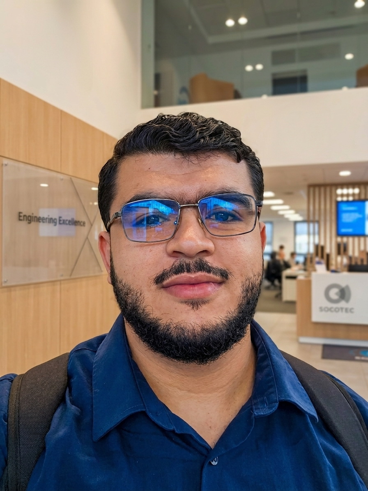

**Data & AI Engineer, basé à Lyon.** 
**[Databricks Certified Data Engineer Associate](https://credentials.databricks.com/4ef911d6-f5a3-43ed-bfc5-15ab97abac23)**

Je construis des pipelines et des applications qui rendent les données utilisables. Mon expérience couvre un lakehouse Databricks sur AWS chez **SOCOTEC Monitoring**, des flux de données de parking en temps réel chez **STM Group** et l'extraction de documents juridiques arabes chez **Shiftbricks**.

Ce qui m'intéresse : comprendre la source, construire le pipeline et aboutir à un outil utilisable.

- **Ingénierie des données :** pipelines lakehouse, capture des changements, orchestration et qualité des données.
- **Développement :** backends Python et Java, API et applications web.
- **IA appliquée :** régression, super-résolution d'images et traitements OCR/NLP.

 

## Expérience professionnelle

### SOCOTEC Monitoring · Data Engineer
**Mars–septembre 2026 · Palaiseau, France**

Au sein du Data & AI Hub, contribution à un lakehouse Databricks sur AWS couvrant environ 30 domaines métier.

- Développement de pipelines ETL/ELT Silver et Gold, dont les jeux de données devis et lignes de devis issus du CDC PostgreSQL via Airbyte ; rapprochement de **plus de 540 000 lignes** pour une migration de reporting Power BI.
- Ingestion incrémentale de **10 objets SAP Field Service Management**, avec OAuth2, pagination et reprise sur erreur.
- Conception d'un framework qualité DQX avec **34 types de contrôles**, et configuration de **101 contrôles** sur quatre domaines. Déploiement avec Databricks Asset Bundles et GitLab CI/CD sur trois environnements.

### STM Group · Data Engineer, stage R&D
**Février–juin 2025 · Tanger, Maroc**

- Synchronisation des bases PostgreSQL de sites de parking vers une plateforme centrale avec **Kafka et Debezium CDC**.
- Création de modèles partagés, de triggers PostgreSQL et d'API **FastAPI** pour les abonnements, les mouvements de véhicules, l'occupation et les revenus.
- Déploiement de **Kubernetes et Strimzi sur DigitalOcean**, avec Tailscale pour relier les bases sur site.

### Shiftbricks · Data & AI Engineer, LegalTech
**Juin–septembre 2024 · Al Hoceima, Maroc**

- Association de l'OCR arabe et des modèles **Cohere** pour extraire **plus de 15 champs par document**, sur un corpus de **plus de 80 documents juridiques**.
- Orchestration d'un pipeline Medallion avec **Airflow et MongoDB**, et création d'une interface **FastAPI et React** pour la validation par des experts.
- Conteneurisation avec **Docker** et livraison via **GitLab CI/CD**.

[Voir mon parcours détaillé](https://akkouhlokmane.netlify.app/#experience)

## Sélection de projets

### PatentAnalysis · Analyse de brevets agricoles

Un projet collectif qui rassemble des données issues de **l'USPTO, Google Patents, l'EPO et la CIPO**. Le pipeline harmonise des formats hétérogènes, stocke les documents dans MongoDB Atlas, les transforme avec PySpark et alimente un entrepôt PostgreSQL. Les tableaux de bord Power BI sont intégrés à une interface web Flask.

<a href="https://github.com/lokmane101/PatentAnalysis">
  <picture>
    <source media="(max-width: 600px)" srcset="assets/pipeline-fr-mobile.svg">
    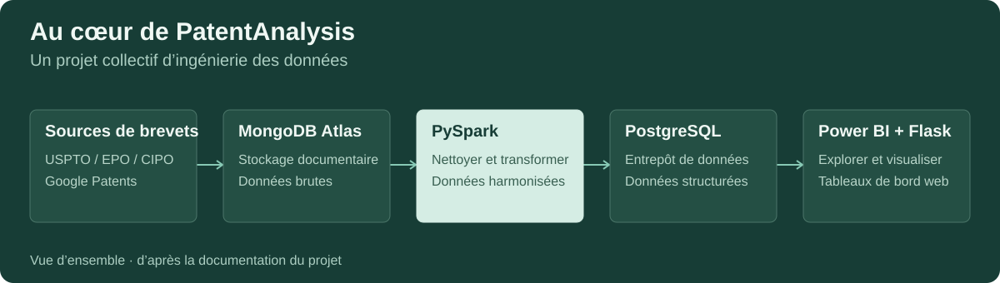
  </picture>
</a>

**Enjeu :** rendre cohérentes des données de sources différentes et relier la collecte à l'analyse. 
**Technologies :** Python, PySpark, MongoDB Atlas, PostgreSQL, Power BI, Flask. 
[Explorer le dépôt](https://github.com/lokmane101/PatentAnalysis)

### Laptop Price Prediction · De l'exploration à l'interface ML

Un projet de régression qui combine des données collectées sur un site e-commerce local et un jeu de données Kaggle. Il couvre l'analyse exploratoire, le nettoyage, le prétraitement et la comparaison de modèles avec **MSE et R²**. La documentation du projet identifie le Gradient Boosting comme le modèle le plus performant parmi ceux évalués. Une interface **Streamlit** permet de saisir les caractéristiques d'un ordinateur et d'obtenir une estimation de son prix.

**Enjeu :** relier l'évaluation des modèles à une interface de prédiction utilisable. 
**Technologies :** Python, Jupyter, scikit-learn, Streamlit. 
[Explorer le dépôt](https://github.com/lokmane101/laptop-price-prediction)

### Tech News Platform · Application full-stack

Une plateforme d'articles techniques avec filtres par catégorie et pages de détail. Le frontend **React et TypeScript** communique avec un backend **FastAPI** ; SQLAlchemy et MySQL assurent la persistance. Le code se trouve dans mon dépôt consacré à un pipeline Azure DevOps.

**Enjeu :** relier une interface interactive, une API et une base relationnelle. 
**Technologies :** React, TypeScript, Vite, FastAPI, SQLAlchemy, MySQL. 
[Explorer le dépôt](https://github.com/lokmane101/CI-CD-pipeline-application-on-azure-DevOps)

<strong>Autres projets : vision par ordinateur, Java et applications de bureau</strong>

| Projet | Sujet | Technologies |
| :--- | :--- | :--- |
| [SRCNN](https://github.com/lokmane101/SRCNN) | Super-résolution d'images avec un réseau de neurones convolutif. | Python, Jupyter, deep learning |
| [Gestion des examens](https://github.com/lokmane101/SpringBootExamManagamentApp) | Gestion des examens, des professeurs et des matières. | Java, Spring Boot, MySQL |
| [Gestion des étudiants](https://github.com/lokmane101/SchoolStudentManagementApp) | Simulation collective d'une application pour les informations étudiantes, les cours et les emplois du temps. | Python, Tkinter, MySQL |
| [Portfolio personnel](https://github.com/lokmane101/GitHubHomePage) | Présentation web de mes projets data, IA et logiciel. | HTML, CSS, JavaScript |

### Également dans mon portfolio · RAG et traitement documentaire

- **[Assistant support XTelecom](https://akkouhlokmane.netlify.app/#xtelecom) :** recherche SQL et documentaire avec **Vertex AI / Gemini**, FastAPI, React et traçage **Langfuse**.
- **[Ingestion de documents juridiques](https://akkouhlokmane.netlify.app/#legal-documents) :** le pipeline Airflow et MongoDB, avec validation humaine, décrit dans mon expérience chez Shiftbricks.

Ces projets sont présentés dans mon portfolio ; aucun dépôt de code public n'y est actuellement associé.

## Mes outils

  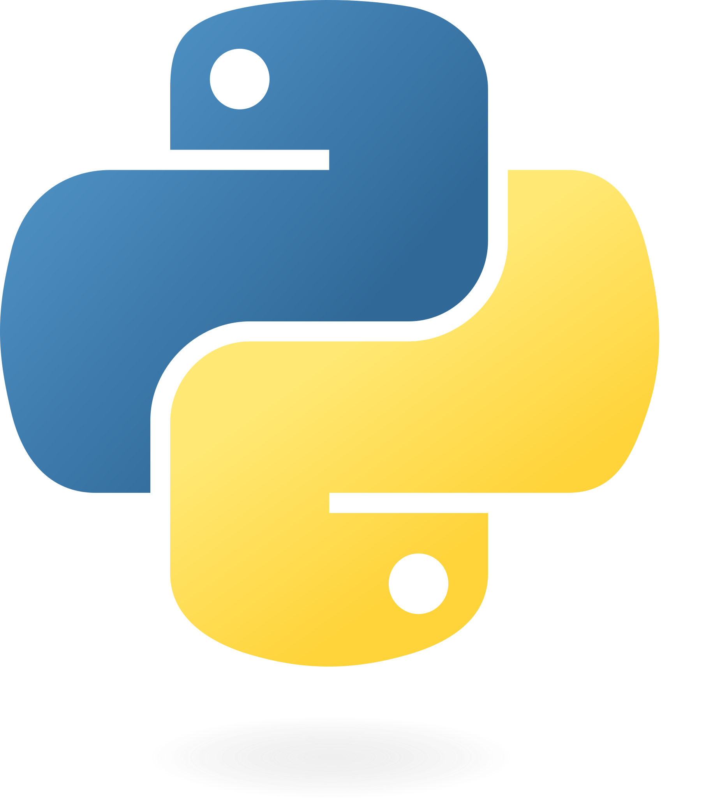 &nbsp;
  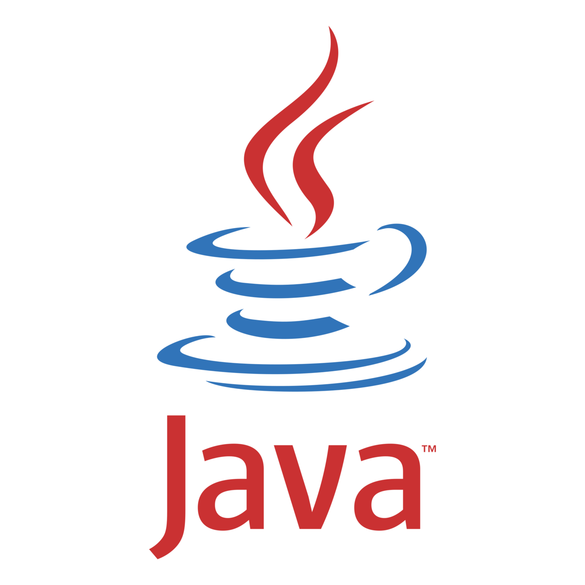 &nbsp;
  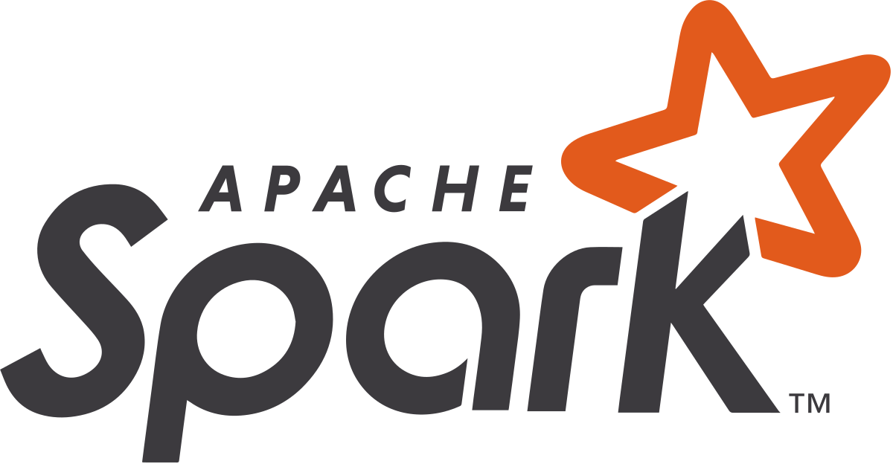 &nbsp;
  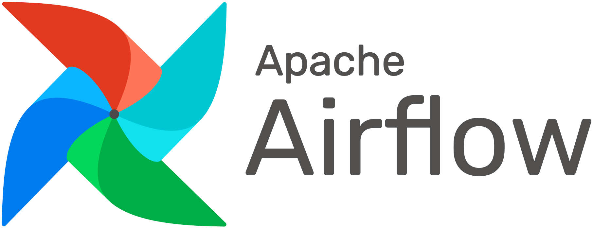 &nbsp;
   &nbsp;
  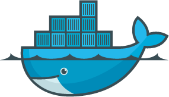 &nbsp;
   &nbsp;
  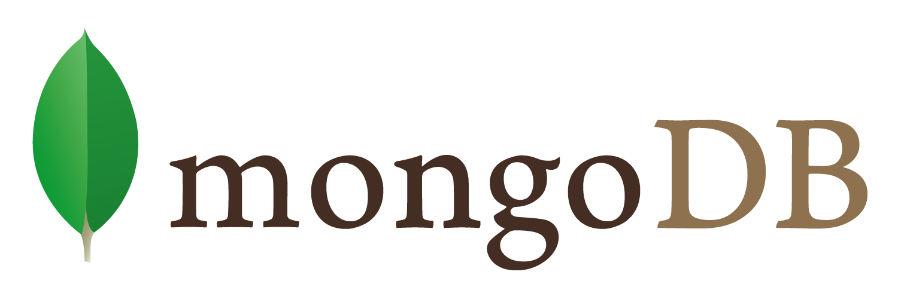 &nbsp;
  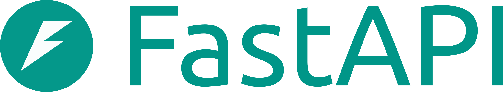 &nbsp;
  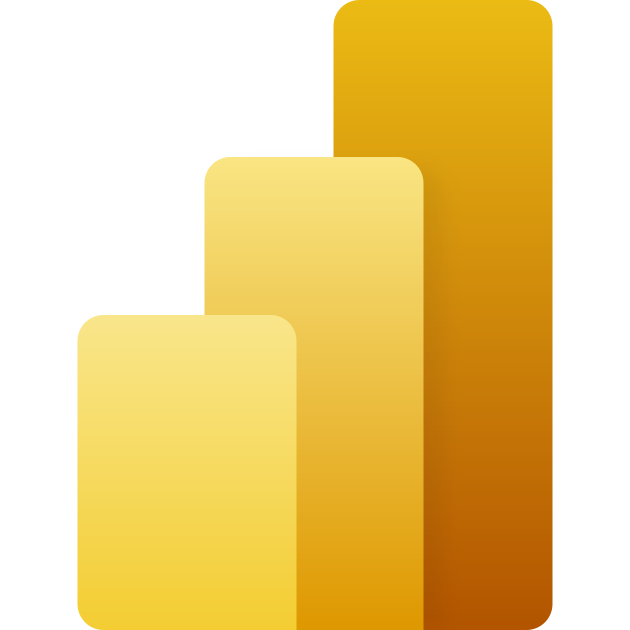

| Domaine | Outils et technologies |
| :--- | :--- |
| Langages | Python, SQL, Java, JavaScript, TypeScript |
| Traitement et orchestration | Databricks, Apache Spark / PySpark, Airflow, Kafka, Debezium, Airbyte |
| Lakehouse et qualité | Delta Lake, Unity Catalog, DQX, Databricks Asset Bundles |
| Stockage et analyse | PostgreSQL, MongoDB Atlas, MySQL, Power BI |
| API et applications | FastAPI, Flask, Spring Boot, React, Streamlit |
| Cloud et livraison | AWS, Azure, DigitalOcean, Docker, Kubernetes, GitLab CI/CD |
| IA et machine learning | scikit-learn, régression, CNN, RAG, Vertex AI / Gemini, Cohere, Langfuse |

## Formation et certification

| Période | Formation | Établissement |
| :--- | :--- | :--- |
| 2025–2026 | Master en Data Science | Université Claude Bernard Lyon 1, France |
| 2020–2025 | Diplôme d'ingénieur en Data Engineering | ENSA Al Hoceima, Université Abdelmalek Essaâdi, Maroc |

**Databricks Certified Data Engineer Associate** — valable jusqu'au **16 août 2028**. [Vérifier la certification](https://credentials.databricks.com/4ef911d6-f5a3-43ed-bfc5-15ab97abac23). 
En préparation : **Databricks Data Engineer Professional** et **IBM Big Data with Spark and Hadoop Essentials**.

## Mes dépôts publics en un regard

<picture>
  <source media="(max-width: 600px)" srcset="assets/repositories-fr-mobile.svg">
  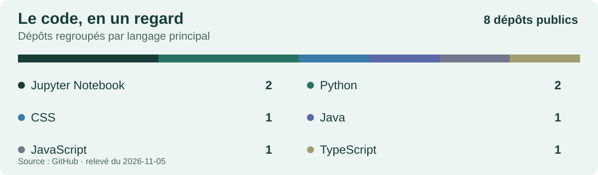
</picture>

Cette photographie compte les dépôts publics hors forks, en excluant le dépôt de ce profil. Chaque dépôt est compté une fois, selon le langage principal déclaré par GitHub. **Elle décrit le code, pas un niveau de compétence.** [Consulter les données sources](assets/repositories.json).

## Échangeons

Tu travailles sur des pipelines data, de l'IA appliquée ou des applications qui rendent les données utiles ? Je serai ravi d'échanger et de discuter d'un projet.

**[M'écrire](mailto:lokmaneakkouh10@gmail.com)** &nbsp; / &nbsp; **[Me retrouver sur LinkedIn](https://www.linkedin.com/in/lokmane-akkouh/)** &nbsp; / &nbsp; **[Voir mon portfolio](https://akkouhlokmane.netlify.app/)**

Lokmane Akkouh · <a href="README.md">English version</a>

