<picture>
  <source media="(max-width: 600px)" srcset="assets/hero-en-mobile.svg">
  
</picture>

  <a href="https://akkouhlokmane.netlify.app/">Portfolio</a> &nbsp; / &nbsp;
  <a href="https://www.linkedin.com/in/lokmane-akkouh/">LinkedIn</a> &nbsp; / &nbsp;
  <a href="mailto:lokmaneakkouh10@gmail.com">Email</a> &nbsp; / &nbsp;
  <a href="https://akkouhlokmane.netlify.app/CV/Lokmane_akkouh_cv.pdf">Résumé</a> &nbsp; / &nbsp;
  <a href="README.fr.md">Lire en français</a>

# Hi, I'm Lokmane.

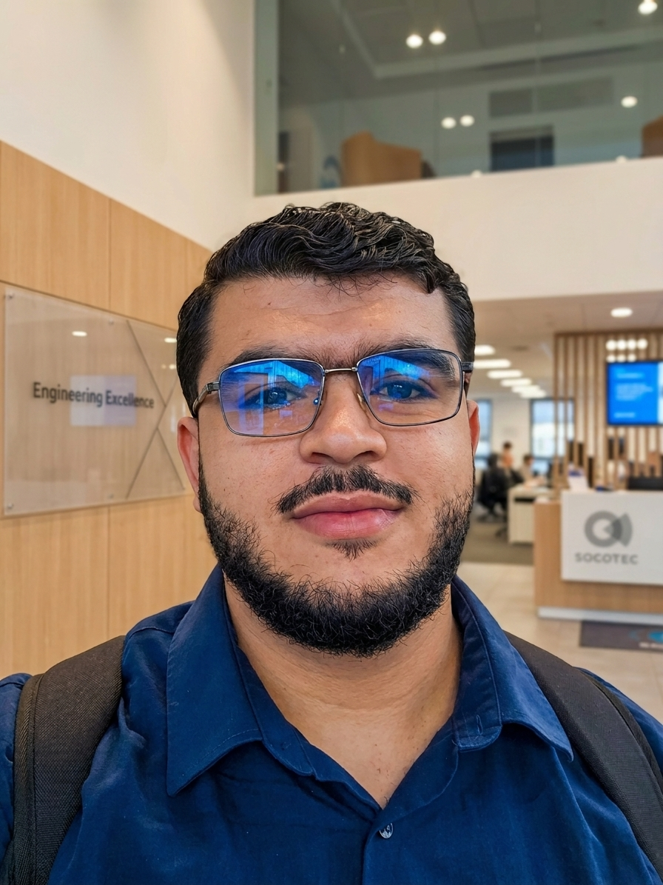

**Data & AI Engineer based in Lyon, France.** 
**[Databricks Certified Data Engineer Associate](https://credentials.databricks.com/4ef911d6-f5a3-43ed-bfc5-15ab97abac23)**

I build data pipelines and applications that connect raw information to practical use. My experience spans an AWS-backed Databricks lakehouse at **SOCOTEC Monitoring**, real-time parking data at **STM Group**, and Arabic legal-document extraction at **Shiftbricks**.

I enjoy working across the full data journey: understanding the source, designing the pipeline and building something people can use.

- **Data engineering:** lakehouse pipelines, change data capture, orchestration and data quality.
- **Software:** Python and Java backends, APIs and web applications.
- **Applied AI:** regression, image super-resolution and OCR/NLP workflows.

 

## Professional experience

### SOCOTEC Monitoring · Data Engineer
**March–September 2026 · Palaiseau, France**

Worked in the Data & AI Hub on an AWS-backed Databricks lakehouse spanning around 30 business domains.

- Built Silver and Gold ETL/ELT pipelines, including quote and quote-line datasets from PostgreSQL CDC via Airbyte; reconciled **540,000+ rows** for a Power BI reporting migration.
- Implemented incremental ingestion for **10 SAP Field Service Management objects**, with OAuth2, pagination and error recovery.
- Designed a DQX quality framework with **34 check types** and configured **101 checks** across four domains. Delivered jobs through Databricks Asset Bundles and GitLab CI/CD across three environments.

### STM Group · Data Engineer, R&D internship
**February–June 2025 · Tanger, Morocco**

- Connected local parking-site PostgreSQL databases to a central platform using **Kafka and Debezium CDC**.
- Built shared data models, PostgreSQL triggers and **FastAPI** services for subscriptions, vehicle movements, occupancy and revenue.
- Deployed **Kubernetes and Strimzi on DigitalOcean**, using Tailscale to connect to on-premise databases.

### Shiftbricks · Data & AI Engineer, LegalTech
**June–September 2024 · Al Hoceima, Morocco**

- Combined Arabic OCR and **Cohere** language models to extract **15+ fields per document** from a corpus of **80+ legal documents**.
- Orchestrated a Medallion pipeline with **Airflow and MongoDB**, with a **FastAPI and React** interface for expert review.
- Containerized the application with **Docker** and delivered it through **GitLab CI/CD**.

[More about my experience](https://akkouhlokmane.netlify.app/#experience)

## Selected work

### PatentAnalysis · Agricultural patent intelligence

A collaborative project that brings together patent data from **USPTO, Google Patents, EPO and CIPO**. The pipeline harmonizes different source formats, stores documents in MongoDB Atlas, transforms them with PySpark and feeds a PostgreSQL warehouse. Power BI dashboards are exposed through a Flask web interface.

<a href="https://github.com/lokmane101/PatentAnalysis">
  <picture>
    <source media="(max-width: 600px)" srcset="assets/pipeline-en-mobile.svg">
    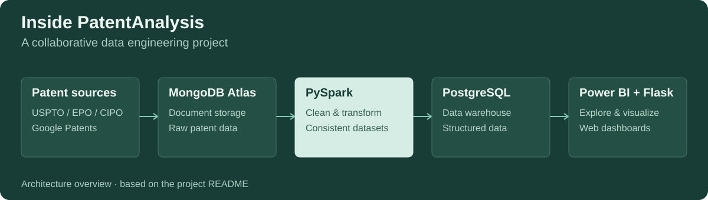
  </picture>
</a>

**Focus:** data consistency across heterogeneous sources; an end-to-end path from collection to analysis. 
**Built with:** Python, PySpark, MongoDB Atlas, PostgreSQL, Power BI, Flask. 
[Explore the repository](https://github.com/lokmane101/PatentAnalysis)

### Laptop Price Prediction · From exploration to an ML interface

An end-to-end regression project combining data scraped from a local e-commerce website with a Kaggle dataset. The work covers exploratory analysis, cleaning, preprocessing and model comparison using **MSE and R²**. The project README identifies Gradient Boosting as the best-performing model among those evaluated; a **Streamlit** interface accepts laptop specifications and returns a predicted price.

**Focus:** connecting model evaluation to a usable prediction interface. 
**Built with:** Python, Jupyter, scikit-learn, Streamlit. 
[Explore the repository](https://github.com/lokmane101/laptop-price-prediction)

### Tech News Platform · Full-stack application

A technical-article platform with category filters and article detail views. A **React and TypeScript** frontend communicates with a **FastAPI** backend, with SQLAlchemy and MySQL handling persistence. The source lives in my Azure DevOps pipeline repository.

**Focus:** connecting an interactive frontend, an API and a relational database. 
**Built with:** React, TypeScript, Vite, FastAPI, SQLAlchemy, MySQL. 
[Explore the repository](https://github.com/lokmane101/CI-CD-pipeline-application-on-azure-DevOps)

<strong>More projects: computer vision, Java and desktop software</strong>

| Project | What it explores | Technologies |
| :--- | :--- | :--- |
| [SRCNN](https://github.com/lokmane101/SRCNN) | Image super-resolution using a convolutional neural network. | Python, Jupyter, deep learning |
| [Exam Management](https://github.com/lokmane101/SpringBootExamManagamentApp) | Managing exams, professors and subjects in a Spring Boot application. | Java, Spring Boot, MySQL |
| [Student Management](https://github.com/lokmane101/SchoolStudentManagementApp) | A collaborative desktop simulation for student information, lessons and schedules. | Python, Tkinter, MySQL |
| [Personal Portfolio](https://github.com/lokmane101/GitHubHomePage) | A web presentation of my data, AI and software projects. | HTML, CSS, JavaScript |

### Also in my portfolio · RAG and document intelligence

- **[XTelecom support assistant](https://akkouhlokmane.netlify.app/#xtelecom):** combines SQL and document retrieval with **Vertex AI / Gemini**, FastAPI, React and **Langfuse** tracing.
- **[Legal document ingestion](https://akkouhlokmane.netlify.app/#legal-documents):** the Airflow, MongoDB and human-validation pipeline described in my Shiftbricks experience.

These project overviews are available in my portfolio; no public source repository is currently linked for them.

## My technical toolkit

  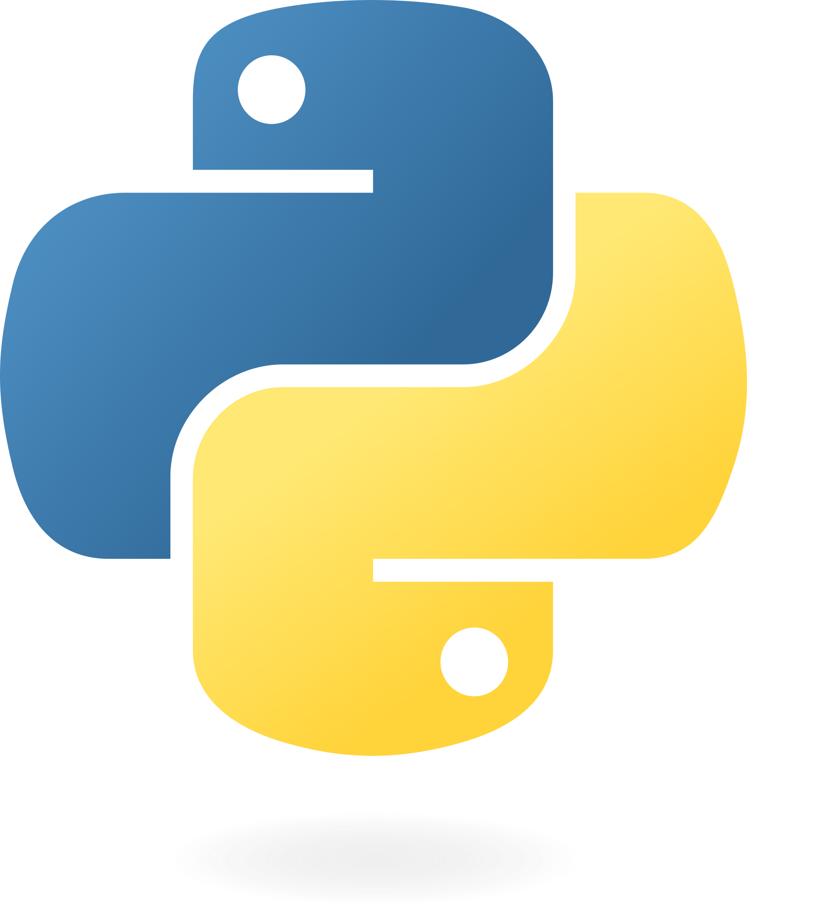 &nbsp;
  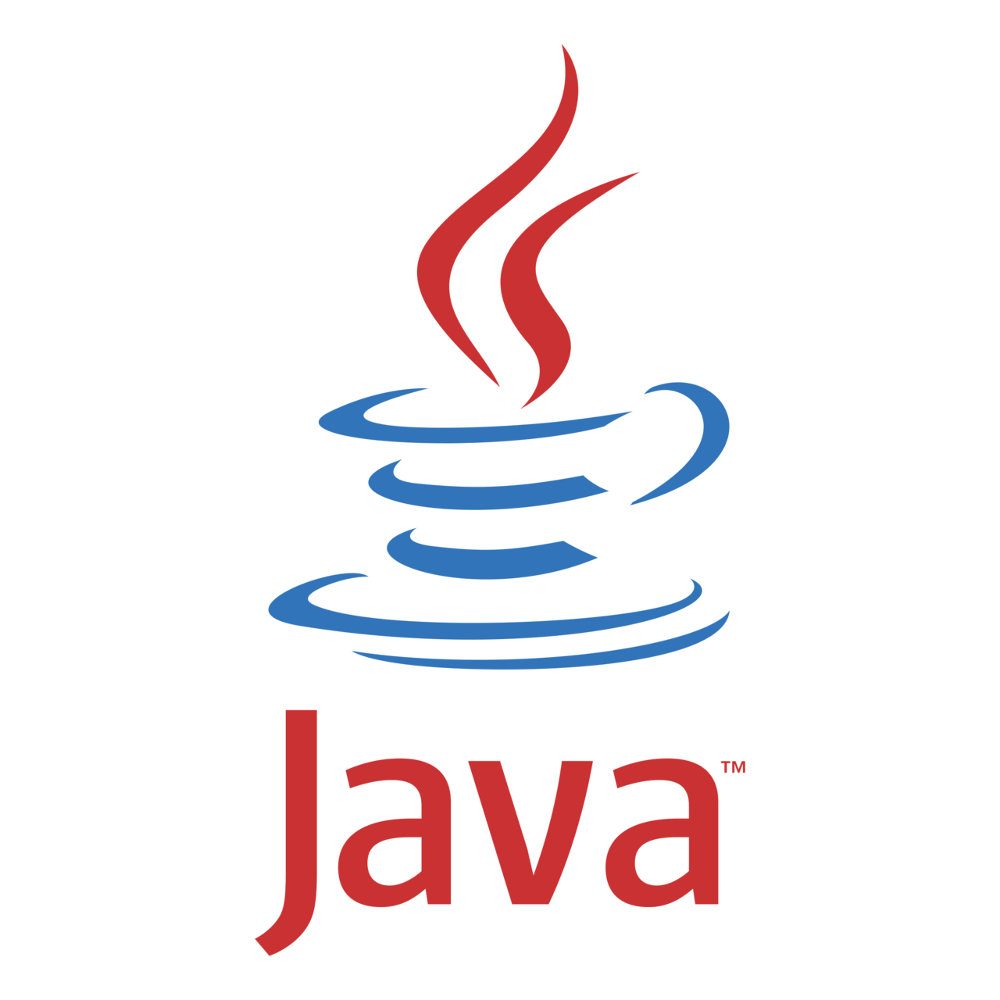 &nbsp;
  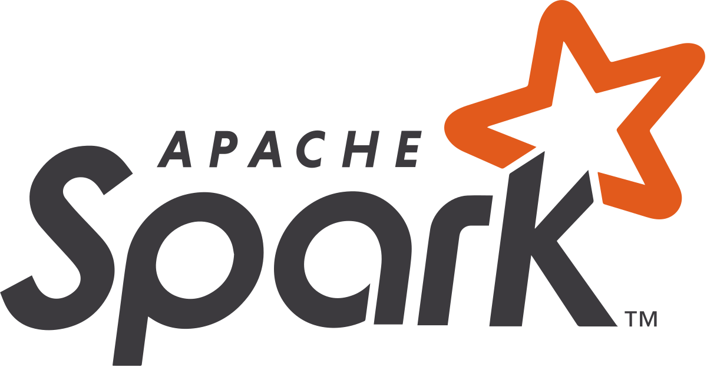 &nbsp;
  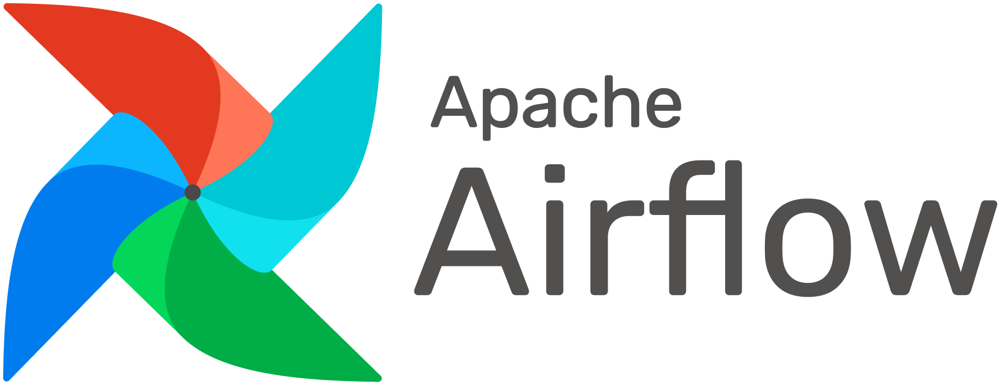 &nbsp;
  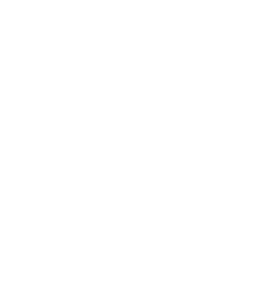 &nbsp;
  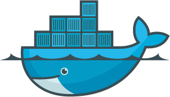 &nbsp;
   &nbsp;
  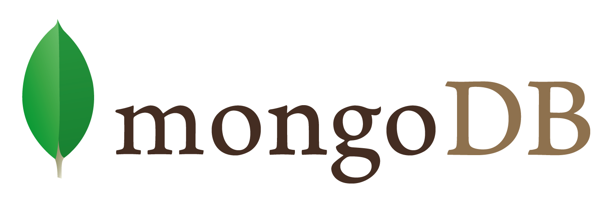 &nbsp;
  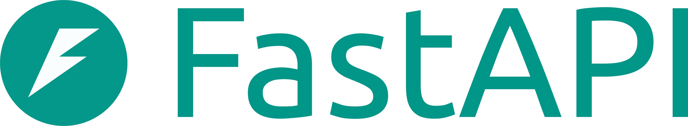 &nbsp;
  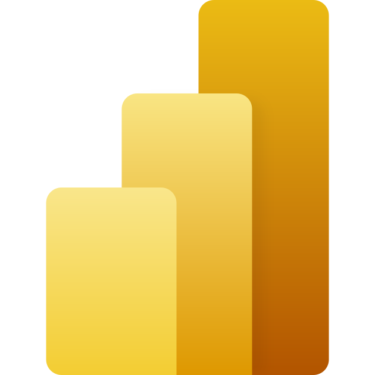

| Area | Tools and technologies |
| :--- | :--- |
| Languages | Python, SQL, Java, JavaScript, TypeScript |
| Data processing & orchestration | Databricks, Apache Spark / PySpark, Airflow, Kafka, Debezium, Airbyte |
| Lakehouse & quality | Delta Lake, Unity Catalog, DQX, Databricks Asset Bundles |
| Storage & analytics | PostgreSQL, MongoDB Atlas, MySQL, Power BI |
| APIs & applications | FastAPI, Flask, Spring Boot, React, Streamlit |
| Cloud & delivery | AWS, Azure, DigitalOcean, Docker, Kubernetes, GitLab CI/CD |
| AI & machine learning | scikit-learn, regression, CNNs, RAG, Vertex AI / Gemini, Cohere, Langfuse |

## Education & certification

| Period | Qualification | Institution |
| :--- | :--- | :--- |
| 2025–2026 | Master's in Data Science | Université Claude Bernard Lyon 1, France |
| 2020–2025 | Engineering degree in Data Engineering | ENSA Al Hoceima, Université Abdelmalek Essaâdi, Morocco |

**Databricks Certified Data Engineer Associate** — valid until **16 August 2028**. [Verify the credential](https://credentials.databricks.com/4ef911d6-f5a3-43ed-bfc5-15ab97abac23). 
Currently preparing: **Databricks Data Engineer Professional** and **IBM Big Data with Spark and Hadoop Essentials**.

## A map of my public code

<picture>
  <source media="(max-width: 600px)" srcset="assets/repositories-mobile.svg">
  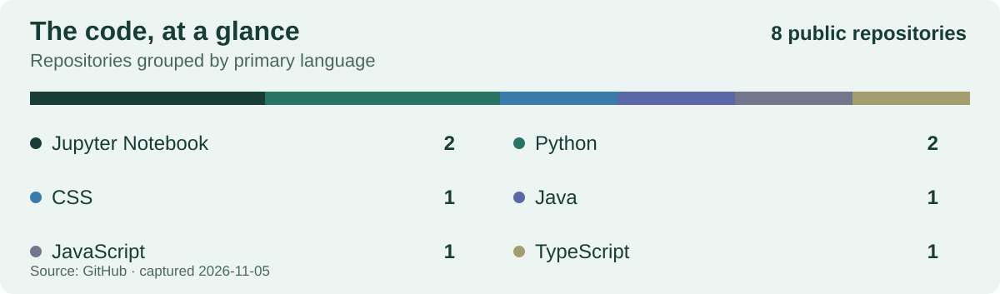
</picture>

This snapshot counts public, non-fork repositories, excluding this profile repository. Each repository is counted once, under the primary language reported by GitHub. **It describes the code, not a skill rating.** [View the source data](assets/repositories.json).

## Let's connect

Interested in data pipelines, applied AI or software that makes data useful? I'd be happy to exchange ideas and discuss a project.

**[Email me](mailto:lokmaneakkouh10@gmail.com)** &nbsp; / &nbsp; **[Connect on LinkedIn](https://www.linkedin.com/in/lokmane-akkouh/)** &nbsp; / &nbsp; **[Visit my portfolio](https://akkouhlokmane.netlify.app/)**

Lokmane Akkouh · <a href="README.fr.md">Version française</a>

